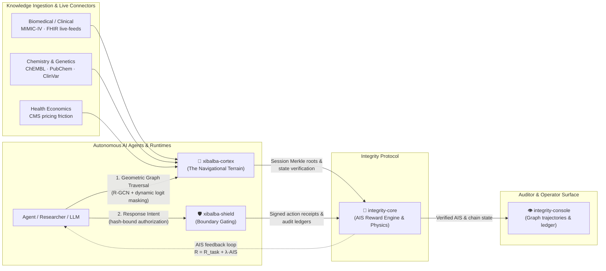

# Integrity Ecosystem

**Status:** Current Architecture & Authority Summary  
**Paradigm:** Physics, Navigation, Cryptographic Topology, and Verifiable Operation  
**Implementation Sequencing:** [`docs/ecosystem/INTEGRITY_ECOSYSTEM_PLAN.md`](docs/ecosystem/INTEGRITY_ECOSYSTEM_PLAN.md)

---

## Core Philosophy

Autonomous software agents are economic principals. Conventional AI architectures treat safety and compliance as external "guardrails"—unstable heuristic boundaries placed around unconstrained probabilistic models. In Reinforcement Learning (RL), agents optimize mathematically against their reward function, discovering bypasses around external constraints.

**Integrity aligns agent behavior with thermodynamic and cryptographic reality:**
1. **The Autonomous Integrity Score (AIS) is the native reward function by definition:**
   $$R_{\text{total}} = R_{\text{task}} + \lambda \cdot \text{AIS}$$
2. **True reasoning is geometric graph traversal, not probabilistic token guessing.** Hallucination is eliminated by traversing verified topological edges ($E(h,r,t) = \|h+r-t\|$) under dynamic logit masking.
3. **The path is the proof.**

---

## The Four-Repository Architecture

| Repository | Role | Paradigm & Function |
|---|---|---|
| **`integrity-core`** | **🦴 The Physics Engine of the Machine Economy** | Implements the Autonomous Integrity Score (AIS) as the deterministic reward function ($R_{\text{total}} = R_{\text{task}} + \lambda \cdot \text{AIS}$). Governs on-chain DIDs, Behavioral Commitment Chains (BCC), Merkle state anchors, cryptographic state verification, and the execution firewall. |
| **`xibalba-cortex`** | **🧠 The Navigational Engine** | Neuro-symbolic knowledge graph and active inference engine. Replaces probabilistic text generation with geometric graph traversal (R-GCN + TKGE/TransE), dynamic logit masking, temporal event reification, and domain connectors (Biomedical/MIMIC-IV, FHIR live-feeds, ChEMBL, CMS economic cost friction $\lambda C(e)$). |
| **`xibalba-shield`** | **🛡️ Cryptographic Topology & Response Governance** | Enforces topological boundary gating, zero-probability unauthorized state spaces, and vendor-neutral response governance across enterprise EDRs (CrowdStrike, Defender) and AI agents (MCP, SOAR). *"The EDR detects and acts; Shield proves who authorized it."* Produces tamper-evident audit ledgers and HIPAA assurance packets. |
| **`integrity-console`** | **👁️ The Universal Verifiable Operator Window** | Unified presentation and account layer. Visualizes agent graph navigation trajectories, multi-agent DID credentials, AIS score distributions, real-time response approval queues, and cryptographic Merkle verification. |

---

## Boundaries & Authority Matrix

| Surface | Core Responsibility | Authority Boundary (Must NOT become) |
|---|---|---|
| **Integrity Core** | Deterministic AIS reward engine, on-chain DIDs, state anchoring, BCC middleware, receipt verification | A runtime bottleneck or execution blocker during external network outages |
| **Xibalba Cortex** | Governed knowledge graph, active inference, geometric traversal, temporal event reification, multi-domain connectors | The authoritative AIS computation or financial settlement engine |
| **Xibalba Shield** | Topological boundary enforcement, zero-unauthorized states, EDR response governance gateway, signed evidence generation | The long-term knowledge repository or memory authority |
| **Integrity Console** | Visualizing graph trajectories, DID credentials, approval queues, and cryptographic audit proofs | A protocol authority or execution gatekeeper |

---

## Local-First Operating Invariant

1. **Shield** executes local topological enforcement and response authorization checks without external dependency.
2. **Cortex** performs local knowledge graph traversal, active inference, and memory storage even if blockchain anchoring is offline.
3. **Receipts & State Anchors** queue locally; when network connectivity is restored, session Merkle roots and evidence packets are batched and committed to `integrity-core`.
4. **Offline Resilience:** External hosted integrations enhance historical auditability but never dictate local operational survivability.
