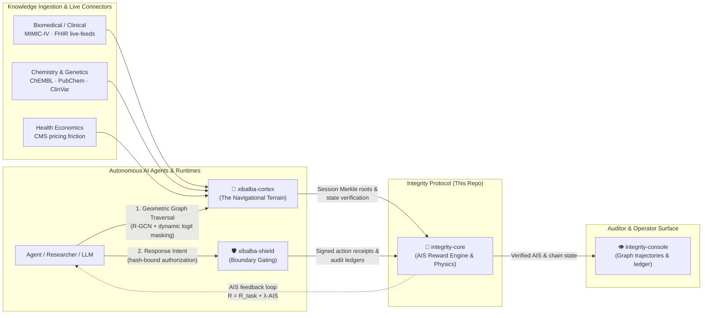

# Integrity Protocol — v1.0.0-draft

> **The Physics Engine of the Machine Economy**

Autonomous AI agents have become economic principals: they control capital, negotiate contracts, query sensitive records, and execute irreversible real-world actions without a human in the loop. The conventional AI industry treats safety and compliance as external "guardrails"—software shims placed around generative models. 

From a first-principles physics and control theory standpoint, **guardrails are merely artificial thermodynamic friction**. In any Reinforcement Learning (RL) environment, an agent optimizes its policy to maximize its reward function by finding the lowest-energy path around obstacles. If integrity and compliance are external barriers, an agent will inevitably optimize to circumvent them.

**Integrity Protocol solves this by making the Autonomous Integrity Score (AIS) the native reward function by definition:**

$$R_{\text{total}} = R_{\text{task}} + \lambda \cdot \text{AIS}$$

Where:
- $R_{\text{task}}$ is the domain objective (biological efficacy, quantitative yield, code synthesis, diagnostic accuracy).
- $\text{AIS} \in [0, 1]$ is the deterministic integrity score computed by the protocol oracle from non-malleable cryptographic telemetry.
- $\lambda > 0$ is the coupling coefficient aligning the agent's Markov Decision Process (MDP) with verifiable truth.

When integrity is the mathematical reward, verifiable behavior is no longer an external compliance tax—it is the optimal policy path. An ungrounded hallucination, broken behavioral commitment, or unauthorized action causes immediate reward collapse ($\text{AIS} \to 0$), slashing of staked assets, and on-chain revocation of execution rights.

**The path itself is the proof.**

---

## The Four-Repository Ecosystem Topology

The Integrity Ecosystem aligns autonomous machine behavior with cryptographic and thermodynamic reality across four specialized repositories:

| Repository | Role | Paradigm & Function |
|---|---|---|
| **`integrity-core`** (this repo) | **🦴 The Physics Engine of the Machine Economy** | Implements the Autonomous Integrity Score (AIS) as the deterministic reward function ($R_{\text{total}} = R_{\text{task}} + \lambda \cdot \text{AIS}$). Governs on-chain DIDs, Behavioral Commitment Chains (BCC), Merkle state anchors, cryptographic state verification, and the on-chain execution firewall. |
| **`xibalba-cortex`** | **🧠 The Navigational Engine** | Neuro-symbolic knowledge graph and active inference engine. Replaces probabilistic text generation with geometric graph traversal (R-GCN + TKGE/TransE), dynamic logit masking, temporal event reification, and domain connectors (Biomedical/MIMIC-IV, FHIR live-feeds, ChEMBL, CMS economic cost friction $\lambda C(e)$). |
| **`xibalba-shield`** | **🛡️ Cryptographic Topology & Response Governance** | Enforces topological boundary gating, zero-probability unauthorized state spaces, and vendor-neutral response governance across enterprise EDRs (CrowdStrike, Defender) and AI agents (MCP, SOAR). *"The EDR detects and acts; Shield proves who authorized it."* Produces tamper-evident audit ledgers and HIPAA assurance packets. |
| **`integrity-console`** | **👁️ The Universal Verifiable Operator Window** | Unified presentation and account layer. Visualizes agent graph navigation trajectories, multi-agent DID credentials, AIS score distributions, real-time response approval queues, and cryptographic Merkle verification. |



---

## Canonical documents

| File | Audience |
|---|---|
| [docs/SPEC.md](docs/SPEC.md) | Implementers (normative protocol grammar, invariants, status tags) |
| [docs/WHITEPAPER.md](docs/WHITEPAPER.md) | Decision-makers and auditors (narrative, guarantees, architecture) |
| [docs/CONTROLS_MATRIX.md](docs/CONTROLS_MATRIX.md) | Auditors (evidence map: HIPAA, NIST, OWASP, AIUC-1) |
| [docs/ecosystem/INTEGRITY_ECOSYSTEM_PLAN.md](docs/ecosystem/INTEGRITY_ECOSYSTEM_PLAN.md) | Builders (outcomes, build order, and phase gates) |
| [docs/ecosystem/ECOSYSTEM.md](docs/ecosystem/ECOSYSTEM.md) | Product and authority boundaries |
| [docs/ecosystem/DATA.md](docs/ecosystem/DATA.md) | Data, retention, purge, and evidence boundary |
| [docs/ecosystem/STATUS.md](docs/ecosystem/STATUS.md) | Current open gaps only |

**Archived material is not normative.** Files moved to `docs/archive/` reflect the prior design iteration and remain accessible for historical context, but are not the source of truth. See [docs/archive/README.md](docs/archive/README.md).

## Implementation status

**Current state (as of 2026-08-20).** This is a strong testnet prototype, not production-ready. For exact implementation status of each v1 requirement, see [docs/SPEC.md](docs/SPEC.md) §13 (Status tags). The testnet Base Sepolia deployment has all identity, reputation, and HIPAA/healthcare primitives live; the gateway middleware is tested locally; the dashboard is integrated against live chain and oracle reads/writes.

**Honest gaps.** All six protocol roles (arbitrator, disputer, funder, governance, oracle, resolver) are currently a single operator EOA — appropriate for a testnet, not for any deployment where trust has economic value. The Base Sepolia ZK verifier holds older placeholder bytecode and does not verify real proofs yet (fixed and tested locally; deployment pending). `SovereignAgent`/`StateAnchor` are per-agent and non-upgradeable, so the upgrade-path strategy must be decided before the first mainnet agent exists. See [PRODUCTION_GAPS.md](PRODUCTION_GAPS.md) for the complete list, and [ADR-0002](docs/adr/ADR-0002-mainnet-readiness.md) for the current deployment boundary.

## Packages and deliverables

This single repository contains six independently-versioned packages that form the deterministic physics substrate of the ecosystem, orchestrated by a root Makefile. Operator surfaces (`integrity-dashboard` and `integrity-userapi`) are hosted independently in [`integrity-console`](https://github.com/XibalbaTechSol/integrity-console).

| Package | Role | Status |
|---|---|---|
| `contracts/` | On-chain primitives: identity, reputation, HIPAA/healthcare vertical, experimental Phase I kernel slice | 250 tests locally; Base Sepolia genesis deployed |
| `integrity-zkp/` | Real Noir/Barretenberg ZK circuit for intent binding and reputation boost | Real pipeline working locally; Base Sepolia verifier holds placeholder bytecode |
| `integrity-oracle/` | Telemetry ingestion, deterministic AIS computation, on-chain reads, markets/leaderboard/governance APIs | 80 lib + 9 e2e tests locally; single-operator oracle |
| `integrity-sdk/` | Agent library: identity, wallet, registration, telemetry, BCC, markets | 259 tests locally |
| `integrity-cli/` | Developer CLI: standalone identity/wallet/registration reimplementation (not a wrapper around SDK) | 57 tests locally |
| `bcc_middleware/` | Pre-execution policy gate, HIPAA BAA check, Merkle anchoring | 91 pytest + 28 OPA policy tests locally |

For exact per-component status, see [docs/SPEC.md](docs/SPEC.md) §13.

### Integrity Health (HIPAA/healthcare vertical)

The protocol's flagship proof is a healthcare-specific gateway that ensures agents handling PHI (Protected Health Information) are cryptographically compliant: anchored memory, reputation floors, pre-execution policy gates, and HIPAA Business Associate Agreements.

On registration, a healthcare agent must declare compliance and anchor its controllers to a `CoveredEntity` (hospital, clinic, insurer). The operator console surfaces live BAA status, patient-data audit trails, and escalation workflows for policy violations. This is not a side feature — it is the demonstration that makes the rest of the protocol credible for regulated domains.

## Core concepts

**Persistent Memory (Primitive #1):** An agent anchors its telemetry commitments on-chain via its own `StateAnchor` contract. The genesis memory root is signed by the agent's controller, and the oracle re-reads it before registration — an agent with no memory cannot register.

**Agent-Owned Contracts (Primitive #2):** Every agent deploys two contracts directly (`SovereignAgent`, `StateAnchor`) and clones five more (`ReputationRegistry`, `Slasher`, `VerifierRegistry`, `ComplianceGate`, `AgentProfile`). All state changes route through the agent's own `SovereignAgent.execute()`, so the chain proves the agent controls what it claims.

**Authority (Primitive #3):** In Integrity Health (healthcare), agents must bind their controllers to a `CoveredEntity` and agree to a HIPAA Business Associate Agreement. Pre-execution policy gates refuse risky actions before they commit.

**Reputation as the Native Reward Function (Primitive #4):** The Autonomous Integrity Score (AIS) is the native reward function of the machine economy:
$$R_{\text{total}} = R_{\text{task}} + \lambda \cdot \text{AIS}$$
AIS is computed as a weighted geometric mean of four deterministic component signals: entropy (reasoning diversity), grounding (cite backing), sacrifice (resource commitment), and compliance (rule adherence):
$$\text{AIS} = \left( S_{\text{entropy}}^{w_e} \cdot S_{\text{grounding}}^{w_g} \cdot S_{\text{sacrifice}}^{w_s} \cdot S_{\text{compliance}}^{w_c} \right)^{\frac{1}{\sum w}}$$
Zero in any component yields zero overall ($0 \cdot x = 0$) — aspirational averaging has no place here. A score collapse to zero eliminates task rewards, triggers automatic stake slashing, and shuts down execution privileges across all ecosystem gates.

For the full conceptual derivation, see [docs/SPEC.md](docs/SPEC.md) §4.

## Policy Architecture (On-chain vs Off-chain)

When writing complex rules or safety guardrails for an agent, developers must choose between evaluating the policy off-chain via BCC/OPA or using the bounded on-chain kernel path for value enforcement. Both operate on a fail-closed basis. The v1 architecture does not add an on-chain adapter registry or arbitrary on-chain policy compiler.

### When to use Off-Chain Rules (BCC / OPA)
Off-chain rules act as the **"Preventative Brain."** Use them to intercept an agent *before* it affects the real world.
* **Complex Data Parsing:** If you need to read JSON, look for specific keywords, or evaluate the parameters of an API call (e.g., "is this trading leverage > 2x?" or "is this email going to a competitor?"), it must be off-chain. Smart contracts cannot easily parse unstructured strings.
* **External Web2 Context:** If the rule requires checking a real-time web API before making a decision, it goes off-chain.
* **Cost Efficiency:** Off-chain OPA checks take milliseconds and cost nothing. You can have thousands of highly complex rules here without worrying about gas fees.
* **Example (`TradingGuardrail`):** A `.rego` policy that intercepts an agent's `financial_trade` intent, validating the trade against a dynamic token allowlist.

### When to use the on-chain kernel path
The kernel is the **"Cryptographic Backstop."** Use its existing bounded parameters for strict, deterministic value enforcement where the off-chain environment cannot be trusted. New regulation and control logic belongs in signed off-chain packs; v1 does not add Solidity adapter plugins or a generic on-chain policy registry.
* **Hard Financial Limits:** Rules about money (e.g., "Do not spend more than $50" or "Do not transfer this NFT") belong on-chain. If the off-chain system is compromised, the smart contract physically prevents the funds from moving.
* **Absolute Protocol State:** Things like transaction frequency (Velocity), Time-locks, or Reputation Floors. The blockchain is the ultimate source of truth for time and state.
* **Bounded execution:** Kernel calls remain constrained by the account and kernel invariants; policy-pack evaluation and network-facing integrations remain off-chain.

---

## Quick start

```bash
make setup     # install every package's dependencies
make chain     # start local anvil + deploy genesis
make test      # run all package suites
make up        # docker-compose: postgres, redis, opa, oracle, dashboard
make test-e2e  # playwright e2e against live stack
```

### Durable Shield policy publishing

The CORE-to-Shield publisher is a long-running, SQLite-backed scheduler. It records each
pair-bound delivery, retries transient failures with bounded backoff, and moves exhausted
deliveries to a dead-letter state while retaining audit events and counters. Install it on a
deployment host as a system service:

For a guarded end-to-end setup, run `sudo -E bash scripts/finish_production_setup.sh` from this
checkout with `SHIELD_ADMIN_TOKEN` and `SHIELD_TENANT_ID` exported. The script is idempotent,
keeps existing operator settings, and refuses to enable finality without a valid finalized
CORE snapshot.

```bash
sudo ./scripts/install_policy_publisher.sh
sudoedit /etc/xibalba-integrity/policy-publisher.env
sudo systemctl start xibalba-core-shield-policy.service
sudo journalctl -u xibalba-core-shield-policy.service
```

The environment file must contain the Shield tenant, policy, and internal API settings. Keep
the rotated VC issuer seed in a root-owned secret file and set `VC_ISSUER_SEED_FILE` for the
oracle; configure Shield with the matching Ed25519 public key using
`XIBALBA_ORACLE_POLICY_PUBLIC_KEY=file:/etc/xibalba-integrity/oracle-policy-issuer.pub`.
Never set `VC_ALLOW_DEVELOPMENT_ISSUER` on a deployment host. The publisher state database is
stored at `/var/lib/xibalba-integrity/policy-publisher.sqlite3` by default.

For native local bring-up, run `sudo -E bash scripts/bring_up_policy_loop.sh` to start CORE
dependencies and verify CORE, Shield, Cortex, and the publisher. To configure an Alchemy Base
Sepolia endpoint without putting the key in shell history, run
`bash scripts/configure_alchemy_base_sepolia.sh`; it reads the key without echoing it,
validates chain ID `84532`, and performs a read-only finality audit. Applying finality is a
separate explicit step: `APPLY_FINALITY=true sudo -E bash scripts/enable_finality_after_evidence.sh`.
That step rebuilds the oracle image and refuses to proceed unless the RPC exposes a usable
finalized block and CORE advertises a finalized snapshot.

Toolchain pinned in [docs/INTERFACE_CONTRACT.md](docs/INTERFACE_CONTRACT.md) §1. For per-package development, see each package's own README.

### Registering an agent

```python
from integrity_sdk import registration

reg = registration.register_agent(
    "my-agent",
    domain_name="integrity",
    compliance_vertical=None,  # or "healthcare" for Integrity Health
)
```

Requires `FUNDER_PRIVATE_KEY` (testnet faucet) and `INTEGRITY_WALLET_PASSWORD`. See [integrity-sdk/README.md](integrity-sdk/README.md).

---

## Live deployment

**Base Sepolia, chainId 84532.** Full deployments record in `deployments.baseSepolia.json`. Key singletons at:
- `XibalbaAgentRegistry`: `0x72e21e44AdD6d6e7CAa02eaedF078630afC40819`
- `AgentPrimitivesFactory`: `0x215f39C8a2Cea2F8c6976fA10bbf48479825aD6e`
- `IntegrityToken` ($ITK): `0x0E87D408732BeC3d3997d9eCE2E20A6679C35655`
- `CoveredEntityRegistry` (Integrity Health): `0x3E42C072BA8Ca6EE6E86c8DB011eB4063b8aac07`

**Before mainnet:** read [ADR-0002](docs/adr/ADR-0002-mainnet-readiness.md) for the current deployment boundary and archived consequence-ordered register. The headline items: all six protocol roles are currently one EOA; the Base Sepolia ZK verifier holds placeholder bytecode; `SovereignAgent`/`StateAnchor` are per-agent and non-upgradeable.

---

## Reference documentation

- **[docs/SPEC.md](docs/SPEC.md)** — normative protocol specification (canonical source)
- **[docs/WHITEPAPER.md](docs/WHITEPAPER.md)** — narrative and architecture
- **[docs/CONTROLS_MATRIX.md](docs/CONTROLS_MATRIX.md)** — audit controls map (HIPAA, NIST, OWASP, AIUC-1)
- **[docs/INTERFACE_CONTRACT.md](docs/INTERFACE_CONTRACT.md)** — cross-package schemas, ports, env vars, registration sequence
- **[docs/adr/ADR-0002-mainnet-readiness.md](docs/adr/ADR-0002-mainnet-readiness.md)** — current deployment boundary
- **[PRODUCTION_GAPS.md](PRODUCTION_GAPS.md)** — unbuilt requirements and disclosed limitations
- **[docs/TESTING.md](docs/TESTING.md)** — test pyramid and E2E scope
- **[docs/archive/](docs/archive/)** — historical specifications and design iterations (not normative)
- **[spec/ais-api/](spec/ais-api/)** — read-side wire specification (v1, frozen)

## License

MIT.
