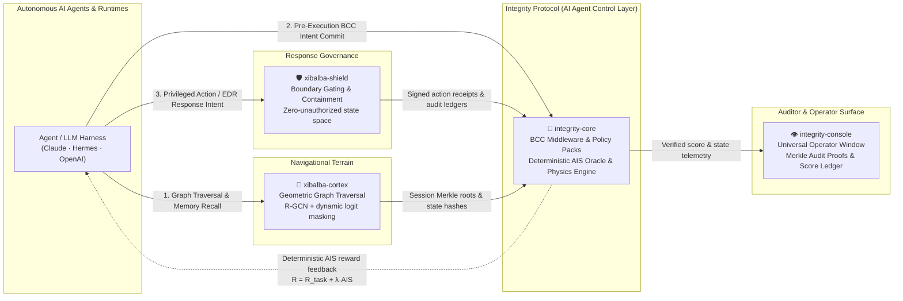

# Ecosystem Dependencies & Four-Repository Topology

This page is the canonical cross-repository dependency and authority map for the four active repositories comprising the Integrity Ecosystem. It reflects the unified architecture established across `integrity-core`, `xibalba-cortex`, `xibalba-shield`, and `integrity-console`.

## Table of contents

- [The Four-Repository Architecture](#the-four-repository-architecture)
- [System Interaction Flow](#system-interaction-flow)
- [Ownership & Runtime Boundaries](#ownership-runtime-boundaries)
- [Dependency Direction & Non-Negotiable Invariants](#dependency-direction-non-negotiable-invariants)
- [Production Cloud Deployments (Render & Supabase)](#production-cloud-deployments-render-supabase)
- [Local-First Operating Invariant](#local-first-operating-invariant)

## The Four-Repository Architecture

The machine economy requires that autonomous AI agents operate under deterministic physical constraints, rigorous geometric navigation, and cryptographic response governance:

| Repository | Role | Paradigm & Function | Production Deployment |
|---|---|---|---|
| **`integrity-core`** | **🦴 The Physics Engine & AI Agent Control Layer** | Implements the Autonomous Integrity Score (AIS) as the deterministic reinforcement learning reward function ($R_{\text{total}} = R_{\text{task}} + \lambda \cdot \text{AIS}$). Governs on-chain DIDs, [Policy Packs](../entities/policy-packs.md), Behavioral Commitment Chains ([BCC](../concepts/bcc.md)), Merkle state anchoring, and the [Integrity Oracle](../entities/integrity-oracle.md). | Oracle: [`https://integrity-oracle.onrender.com`](https://integrity-oracle.onrender.com) |
| **`xibalba-cortex`** | **🧠 The Navigational Engine** | Neuro-symbolic knowledge graph and active inference engine. Replaces probabilistic next-token generation with geometric graph traversal (R-GCN + TKGE/TransE), dynamic logit masking, temporal event reification, and domain connectors (Biomedical/MIMIC-IV, FHIR live-feeds, ChEMBL, CMS cost friction). | Managed Pilot: [`https://cortex-managed-pilot.onrender.com`](https://cortex-managed-pilot.onrender.com) |
| **`xibalba-shield`** | **🛡️ Cryptographic Topology & Response Governance** | Enforces topological boundary gating, zero-probability unauthorized state spaces, and vendor-neutral response governance across enterprise EDRs (CrowdStrike, Microsoft Defender) and AI agents (MCP, SOAR). *"The EDR detects and acts; Shield proves who authorized it."* Produces signed action receipts and tamper-evident audit ledgers. | Cloud Console: [`https://xibalba-shield.onrender.com`](https://xibalba-shield.onrender.com) |
| **`integrity-console`** | **👁️ The Universal Verifiable Operator Window** | Unified presentation and account layer (housing `integrity-dashboard` and `integrity-userapi`). Visualizes agent graph navigation trajectories, multi-agent DID credentials, AIS score distributions, real-time response approval queues, and cryptographic Merkle verification proofs. | Operator Window: [`https://integrity-console-test.onrender.com`](https://integrity-console-test.onrender.com) |

---

## System Interaction Flow

---

## Ownership & Runtime Boundaries

| Surface | Core Responsibility | Authority Boundary (Must NOT become) |
|---|---|---|
| **Integrity Core** | Deterministic AIS reward engine, on-chain DIDs, state anchoring, BCC middleware, policy packs, receipt verification | A runtime bottleneck or execution blocker during external network outages |
| **Xibalba Cortex** | Governed knowledge graph, active inference, geometric traversal, temporal event reification, multi-domain connectors | The authoritative AIS computation or financial settlement engine |
| **Xibalba Shield** | Topological boundary enforcement, zero-unauthorized states, EDR response governance gateway, signed evidence generation | The long-term knowledge repository or memory authority |
| **Integrity Console** | Visualizing graph trajectories, DID credentials, approval queues, and cryptographic audit proofs | A protocol authority or execution gatekeeper |

---

## Dependency Direction & Non-Negotiable Invariants

1. **One-Way Dependency Flow:**
   $$\text{integrity-console} \longrightarrow \{\text{integrity-core}, \text{xibalba-cortex}, \text{xibalba-shield}\}$$
   $$\{\text{xibalba-cortex}, \text{xibalba-shield}\} \longrightarrow \text{integrity-core (Public APIs only)}$$
   `integrity-core` protocol packages **never** import, call, or depend upon Cortex, Shield, or Console.
2. **Local Operational Independence:**
   A failure, network partition, or downtime in `integrity-console`, `xibalba-cortex`, or `xibalba-shield` must **never** prevent `integrity-core` from evaluating local policy packs, enforcing BCC commitments, or validating cryptographic signatures.
3. **Receipt & Evidence Coupling:**
   External events produce self-contained, signed cryptographic receipts (`integrity.receipt/1`) that are submitted into `integrity-core`'s telemetry ingestion pipeline via public endpoints.

---

## Production Cloud Deployments (Render & Supabase)

All four ecosystem components have dedicated production deployments on Render backed by Supabase infrastructure:

- **Xibalba Shield:**
  - Production URL: [`https://xibalba-shield.onrender.com`](https://xibalba-shield.onrender.com)
  - Health Endpoint: `/api/shield/health`
  - Function: Device commissioning (RFC 8628), fleet policy distribution, and EDR response governance.
- **Xibalba Cortex:**
  - Production URL: [`https://cortex-managed-pilot.onrender.com`](https://cortex-managed-pilot.onrender.com)
  - Health Endpoint: `/healthz`
  - Function: Multi-tenant managed knowledge graph, active inference API, and structured data imports.
- **Integrity Oracle:**
  - Production URL: [`https://integrity-oracle.onrender.com`](https://integrity-oracle.onrender.com)
  - Health Endpoint: `/v1/health`
  - Function: Ingests OTel spans, validates admissible evidence, computes the deterministic AIS score, and anchors state.
- **Integrity Console:**
  - Production URL: [`https://integrity-console-test.onrender.com`](https://integrity-console-test.onrender.com)
  - Function: Single-pane operator portal, interactive wiki browser, and multi-agent credentials management.

---

## Local-First Operating Invariant

1. **Shield** executes local topological boundary gating and process containment directly on the host using eBPF/OS probes without relying on cloud availability.
2. **Cortex** traverses local SQLite knowledge graphs (`graph-memory.sqlite3`), computes active inference, and resolves vector recall even when external networks are unreachable.
3. **Core BCC Middleware** evaluates developer Policy Packs in under 1 millisecond using local OPA or embedded WASM runtimes.
4. **State Anchoring Resilience:** When connectivity is interrupted, telemetry and commitment receipts are queued locally in append-only SQLite/JSONL stores; upon reconnection, session Merkle roots are batched and committed to Base L2 and Supabase.
