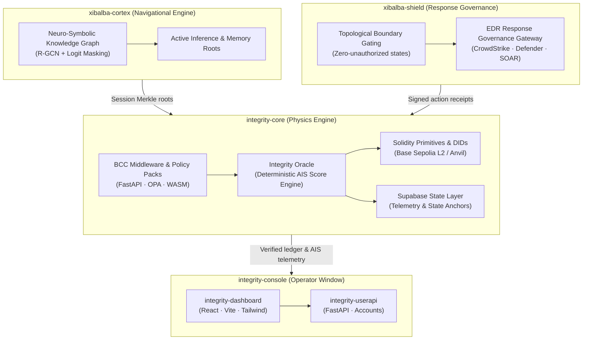

# Repository Implementation Plans & Implementation Ledger

This page is the cross-repository implementation status, architectural milestones, and verification ledger across the Integrity Protocol product stack.

## Table of contents

- [The Four Repositories & Authority Matrix](#the-four-repositories-authority-matrix)
- [System Architecture & Dependency Flow](#system-architecture-dependency-flow)
- [Verification Evidence & Milestone Status](#verification-evidence-milestone-status)
  - [1. integrity-core (Physics Engine & AI Agent Control Layer)](#1-integrity-core-physics-engine-ai-agent-control-layer)
  - [2. xibalba-cortex (Navigational Engine)](#2-xibalba-cortex-navigational-engine)
  - [3. xibalba-shield (Cryptographic Topology & Response Governance)](#3-xibalba-shield-cryptographic-topology-response-governance)
  - [4. integrity-console (Universal Operator Window)](#4-integrity-console-universal-operator-window)
- [Deployment Topologies (Cloud & Local)](#deployment-topologies-cloud-local)

## The Four Repositories & Authority Matrix

| Repository | Scope & Authority | Upstream / Downstream Relationship |
|---|---|---|
| **`integrity-core`** | **Deterministic Physics & Control Layer:** Solidity primitive suite, on-chain DIDs, [Policy Packs](../entities/policy-packs.md), [BCC Middleware](../entities/bcc_middleware.md), [Integrity Oracle](../entities/integrity-oracle.md) (AIS reward engine), Python SDK & CLI. | Authoritative for protocol standards, AIS mathematical derivation, and on-chain state anchors. |
| **`xibalba-cortex`** | **Navigational Engine:** Neuro-symbolic knowledge graph (R-GCN + TKGE/TransE), dynamic logit masking, temporal DAG reification, active inference, multi-domain biomedical/economic connectors. | Upstream provider of structured reasoning and recall paths; anchors session roots to `integrity-core`. |
| **`xibalba-shield`** | **Response Governance:** Endpoint boundary enforcement, zero-unauthorized states, vendor-neutral EDR (CrowdStrike, Defender) & agent SOAR response authorization. | Submits signed containment and response receipts into `integrity-core` telemetry. |
| **`integrity-console`** | **Operator Window:** Unified web dashboard and user account API (`integrity-userapi`, `integrity-dashboard`). | Downstream consumer displaying telemetry, graph trajectories, approval queues, and Merkle audit trails. |

---

## System Architecture & Dependency Flow

---

## Verification Evidence & Milestone Status

### 1. `integrity-core` (Physics Engine & AI Agent Control Layer)
- [x] **Autonomous Integrity Score (AIS) Reward Loop:** Repositioned as the native reinforcement learning reward function ($R_{\text{total}} = R_{\text{task}} + \lambda \cdot \text{AIS}$).
- [x] **Developer Policy Packs (`integrity.pack/1`):** Complete signed policy pack system (`packs/base`, `packs/bcc`, `packs/hipaa`) with Ed25519 hash-bound manifests.
- [x] **Dual Policy Engine:** High-performance pre-execution evaluation supporting both dedicated local OPA and sub-millisecond in-process WASM engine.
- [x] **Supabase State Migration:** Phases 0–6 completed, establishing unified, production-grade cloud persistence with TimescaleDB compatibility shim.
- [x] **Oracle Deployment on Render:** Live at [`https://integrity-oracle.onrender.com`](https://integrity-oracle.onrender.com) with automated health probes and OTel telemetry ingestion.
- [x] **Sovereign Identity Primitives:** `SovereignAgent`, `XibalbaAgentRegistry`, `StateAnchor`, `AgentPrimitivesFactory`, and `AgentAuthorityResolver` fully verified in Foundry suite (209/209 passing).
- [ ] **Mainnet Readiness (ADR-0002):** Deployment of multi-sig governance roles, automated slasher escalation, and Base Mainnet contract verification.

### 2. `xibalba-cortex` (Navigational Engine)
- [x] **Geometric Graph Traversal:** Replaced unconstrained next-token prediction with deterministic traversal over structured knowledge graphs (R-GCN + TKGE/TransE).
- [x] **Dynamic Logit Masking:** Structural elimination of hallucination via dynamic projection masking ($z_{\text{masked}} = z \circ M + (-\infty \times (1 - M))$).
- [x] **Temporal Event Reification:** Directed Acyclic Graph (DAG) event logging preserving clinical and causal temporal sequences.
- [x] **Managed Cloud Service:** Live at [`https://cortex-managed-pilot.onrender.com`](https://cortex-managed-pilot.onrender.com).
- [x] **Live Biomedical Connectors:** MIMIC-IV, FHIR live feeds, ChEMBL, and CMS economic cost friction interfaces.

### 3. `xibalba-shield` (Cryptographic Topology & Response Governance)
- [x] **Response Governance Gateway:** Vendor-neutral authorization layer for enterprise EDRs (CrowdStrike, Defender) and agent SOAR tools.
- [x] **Topological Boundary Gating:** Host-level execution containment via eBPF probes and OS process controls.
- [x] **RFC 8628 Device Pairing:** Hardware and endpoint commissioning protocol connected to the cloud control plane.
- [x] **Cloud Control Plane on Render:** Live at [`https://xibalba-shield.onrender.com`](https://xibalba-shield.onrender.com).
- [x] **HIPAA Assurance Packets:** Tamper-evident, cryptographically signed audit ledgers proving authorization for every containment action.

### 4. `integrity-console` (Universal Operator Window)
- [x] **Standalone Presentation Layer:** Cleanly decoupled from `integrity-core` into an independent repository for enterprise deployment flexibility.
- [x] **Production Operator Portal:** Live at [`https://integrity-console-test.onrender.com`](https://integrity-console-test.onrender.com).
- [x] **Visual Graph Traversal:** Interactive rendering of agent navigation trajectories, active reasoning graphs, and memory associations.
- [x] **Verifiable Audit Explorer:** Real-time inspection of multi-agent DID credentials, AIS distributions, and Merkle proof trees.

---

## Deployment Topologies (Cloud & Local)

| Component | Production Cloud Endpoint | Local Development Endpoint |
|---|---|---|
| **Integrity Oracle** | [`https://integrity-oracle.onrender.com`](https://integrity-oracle.onrender.com) | `http://localhost:8080` |
| **BCC Middleware** | Internal Render Service | `http://localhost:8000` |
| **Xibalba Cortex** | [`https://cortex-managed-pilot.onrender.com`](https://cortex-managed-pilot.onrender.com) | `http://localhost:9443` |
| **Xibalba Shield** | [`https://xibalba-shield.onrender.com`](https://xibalba-shield.onrender.com) | `http://localhost:9444` |
| **Integrity Console** | [`https://integrity-console-test.onrender.com`](https://integrity-console-test.onrender.com) | `http://localhost:5173` |
