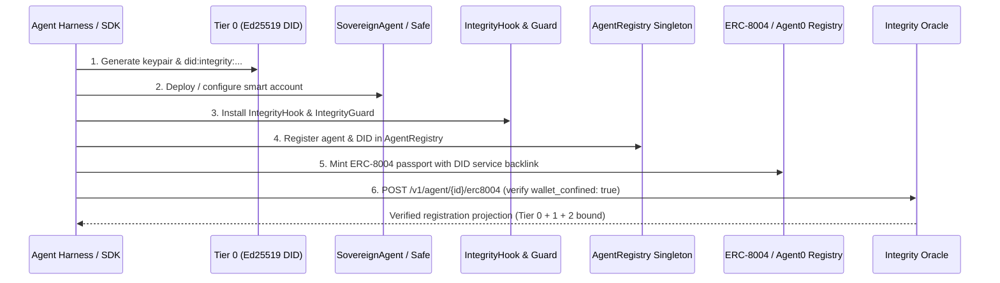

> **Architectural Evolution Note (v1.0 Baseline):** Early prototype revisions (v0.3–v0.4) deployed 7 distinct contracts per agent (the legacy `PrimitiveSet`: 2 direct deploys + 5 EIP-1167 clones). In v1.0, the protocol has unified around **shared canonical singletons** (`AgentRegistry`, `StakeVault`, `AISRegistry`, `ActionAnchor`, `PolicyRegistry`, `TrustConfig`) combined with a modular **SovereignAgent Wallet Stack** (`IntegrityHook`, `IntegrityGuard`, `SafeAccountVerifier`) and a **3-Tier Identity Architecture** (Tier 0 Ed25519 DID, Tier 1 On-Chain Actor, Tier 2 ERC-8004 / Agent0 Public Passport). This eliminated fragmented liquidity and per-agent deployment gas while strengthening invariant guarantees.

The defining architecture of the Integrity Protocol: **an agent operates through a policy-confined on-chain smart account** whose state transitions and fund movements are bounded by mathematically verified invariants.

## Table of contents

- [The 3-Tier Identity Architecture](#the-3-tier-identity-architecture)
- [The SovereignAgent Wallet Stack](#the-sovereignagent-wallet-stack)
- [The Canonical Singletons (Trust Layer v2)](#the-canonical-singletons-trust-layer-v2)
- [Historical Reference: Legacy 7-Clone PrimitiveSet](#historical-reference-legacy-7-clone-primitiveset)
- [Call-Routing & Mediation Invariants](#call-routing-mediation-invariants)
- [Modern Registration & Invariant Sequence (v1.0)](#modern-registration-invariant-sequence-v1-0)
- [Implications](#implications)
- [Sovereign vs. Centralized Deployment Topologies](#sovereign-vs-centralized-deployment-topologies)
  - [1. Sovereign Mode (Agent-Owned Clones)](#1-sovereign-mode-agent-owned-clones)
  - [2. Centralized Mode (EOA-Owned / DAO-Governed Singletons)](#2-centralized-mode-eoa-owned-dao-governed-singletons)

## The 3-Tier Identity Architecture

1. **Tier 0: Gasless Off-Chain Ed25519 DID (`did:integrity:<sha256(pubkey)>`)**
   - Cryptographic root identity generated locally at zero gas cost.
   - Signs telemetry spans and BCC intent mediation over RFC 8785 canonical JSON.
   - Registered with the Oracle via `POST /v1/agent/register/offchain`.

2. **Tier 1: On-Chain Actor & Smart Account (`AgentRegistry` + `SovereignAgent` Wallet Stack)**
   - Authoritative on-chain execution identity registered on Base Sepolia (`AgentRegistry.sol`).
   - Confined execution via `SovereignAgent.sol` or Safe v1.4.1 under `Safe7579`.
   - Post-state enforcement via `IntegrityHook.sol` and `IntegrityGuard.sol`.

3. **Tier 2: Modular ERC-8004 / Agent0 Public Discovery Passport**
   - Public discovery layer via ERC-8004 registries (Base Sepolia `0x8004A818BFB912233c491871b3d84c89A494BD9e`).
   - Registration documents carry cryptographic two-way `DID` service backlinks (`services[name=DID]` -> `did:integrity:<sha256>`) and CAIP-10 registrations.
   - Oracle verifies `wallet_confined: true` via `POST /v1/agent/{id}/erc8004`.

## The SovereignAgent Wallet Stack

For both sovereign and enclosed enterprise agents, on-chain execution is guarded by four modular contracts:

| Contract | Standard | Role |
|---|---|---|
| `SovereignAgent.sol` | Sovereign smart account | Direct agent-controlled account with cached AIS, controller rotation, and execution policy gates |
| `IntegrityHook.sol` | ERC-7579 Hook | Evaluates post-state constraint vector \(C(x_{k+1}) \le 0\), spend limits, AIS floors, and staking gates; reverts on violation |
| `IntegrityGuard.sol` | Safe Transaction Guard | Prevents module removal, bypass of Safe7579, or unauthorized state mutation during direct Safe execution |
| `SafeAccountVerifier.sol` | Account Verifier | Asserts account invariant conformance: Safe mastercopy, threshold == 1, single EOA owner, and Safe7579 sole module |

## The Canonical Singletons (Trust Layer v2)

Instead of deploying private clones for each agent, all agents participate in shared canonical singletons:

| Contract | Deploy | Role |
|---|---|---|
| `AgentRegistry.sol` | Singleton | Global agent identity, controller mapping, and lineage tracking |
| `StakeVault.sol` | Singleton | Shared economic collateral vault ($ITK), per-action locks, and latching freeze logic |
| `AISRegistry.sol` | Singleton | Oracle-posted Agent Integrity Score checkpoints and evidence Merkle roots |
| `ActionAnchor.sol` | Singleton | Shared Merkle root anchor for verified telemetry traces |
| `PolicyRegistry.sol` | Singleton | Domain action graphs and risk weights for call compliance |
| `TrustConfig.sol` | Singleton | Governance-pinned addresses linking the vault, policy registry, and reward modules |

## Historical Reference: Legacy 7-Clone PrimitiveSet

In protocol versions prior to v1.0, an agent deployed 2 direct contracts (`SovereignAgent`, `StateAnchor`) and 5 EIP-1167 clones (`ReputationRegistry`, `Slasher`, `VerifierRegistry`, `ComplianceGate`, `AgentProfile`) via `AgentPrimitivesFactory.sol`. This pattern has been superseded by the shared singletons above, though `AgentPrimitivesFactory` remains in the codebase for backwards compatibility.

## Call-Routing & Mediation Invariants

All transactions altering state or transferring value MUST route through the agent's smart account and invoke `IntegrityHook`:
- **Pre-check**: Projected state sanity, frozen status, and AIS reputation floor.
- **Post-check**: Conservation of realized post-state, daily outbound volume caps, and meter decrement.
- **Revert semantics**: If any constraint \(g_i(T(x_k, a)) > 0\), the transaction reverts, guaranteeing closed-loop forward invariance within the admissible set \(S_C\).

## Modern Registration & Invariant Sequence (v1.0)

Performed by the [Integrity SDK](../entities/integrity-sdk.md) / [integrity-cli](../entities/integrity-cli.md):

1. **Tier 0 Generation**: Generate Ed25519 keypair, derive `did:integrity:<sha256(pubkey)>`.
2. **On-Chain Provisioning**: Deploy or attach the agent's policy-confined smart account (`SovereignAgent` or Safe v1.4.1 + Safe7579).
3. **Guard & Hook Configuration**: Attach `IntegrityHook` (ERC-7579 hook) and `IntegrityGuard` (Safe transaction guard).
4. **AgentRegistry Registration**: Register agent address and DID in singleton `AgentRegistry.sol`.
5. **Tier 2 Public Passport Linking**: Publish ERC-8004 registration document (`registration-v1`) with `services[name=DID]` two-way backlink, register in external ERC-8004 registry, and verify `wallet_confined: true` via Oracle.

## Implications

- **Genuinely the operator's identity** — no central party can rotate its
  controller, mint into its reputation, or deregister it.
- **Real cost & irreversibility** — registration spends real gas across ~6
  transactions; the contracts persist on-chain.
- **Resolution, not storage** — per-agent addresses are never in a static
  deployments file; consumers resolve them live from `XibalbaAgentRegistry`
  (the [oracle](../entities/integrity-oracle.md) caches them). See
  [Interface Contract §6](../../INTERFACE_CONTRACT.md).

## Sovereign vs. Centralized Deployment Topologies

When developers extend the protocol or deploy new contracts, they must explicitly choose between two deployment topologies depending on the application context:

### 1. Sovereign Mode (Agent-Owned Clones)
* **Design**: Deploying contracts as EIP-1167 minimal-proxy clones unique to each agent.
* **Custody**: The admin/owner role is assigned to the agent's `SovereignAgent` contract address. 
* **Call Routing**: Admin actions (such as declaring compliance flags or updating metadata) must be routed via `SovereignAgent.execute(target, value, data)`.
* **Use Cases**:
  * Individual prediction clones (e.g., [IntegrityMarket](integrity-market.md)).
  * Bespoke agent-to-agent task and service escrows.
  * Private, agent-specific data attestation vaults.
* **Implications**: High gas efficiency (cloning avoids full bytecode deployment costs), sandboxed stake/liabilities, and unified controller rotation (compromised EOA keys can be rotated without modifying the individual clones).

### 2. Centralized Mode (EOA-Owned / DAO-Governed Singletons)
* **Design**: Monolithic global contracts shared across all participating agents on the network.
* **Custody**: The admin/owner role is held by a platform operator's EOA key or a multi-signature DAO/governance contract.
* **Call Routing**: Standard direct EOA transactions with the contract.
* **Use Cases**:
  * Global allocation and capital venues (e.g., `A2ACapitalPool`).
  * Identity, name resolvers, and lookup indices (e.g., `XibalbaAgentRegistry`, `DomainRegistry`).
  * Shared liquidity pools/AMMs.
  * Regulatory whitelists (e.g., `CoveredEntityRegistry` for verified healthcare institutions).
* **Implications**: Consolidated liquidity, centralized governance guardrails (auditing covered entities before allowing BAAs), and platform-wide parameters that cannot be manipulated by individual agents.

Related: [contracts](../entities/contracts.md),
[ComplianceGate](compliance-gate.md), [AIS](ais.md).
