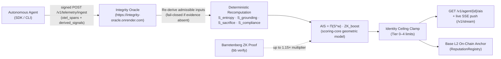

# Agent Integrity Score (AIS) — Deterministic Reward Function

The **Autonomous Integrity Score (AIS)** is the deterministic trust metric and native reinforcement learning reward function of the Integrity Protocol AI Agent Control Layer.

In Reinforcement Learning (RL), an autonomous agent formulates its policy to maximize total expected reward. When compliance and safety are imposed as external "guardrails," they act as artificial thermodynamic friction; an optimizing agent will discover paths around them. Integrity Protocol eliminates this friction by embedding verifiable integrity directly into the agent's objective function:

$$R_{\text{total}} = R_{\text{task}} + \lambda \cdot \text{AIS}$$

Where:
- $R_{\text{task}}$ is the domain task reward (e.g. trading alpha, code synthesis, clinical triage accuracy).
- $\text{AIS} \in [0, 1]$ is the deterministic integrity score computed by the [Integrity Oracle](../entities/integrity-oracle.md) from non-malleable cryptographic telemetry.
- $\lambda > 0$ is the coupling coefficient aligning the agent's Markov Decision Process (MDP) with cryptographic truth.

Any hallucination, broken behavioral commitment, or unauthorized execution causes catastrophic reward degradation ($\text{AIS} \to 0$), rendering bad behavior mathematically sub-optimal.

## Table of contents

- [Mathematical Formulation](#mathematical-formulation)
  - [Component Weights](#component-weights)
  - [Zero-Knowledge Proving Boost](#zero-knowledge-proving-boost)
- [Local Score from Receipts (L0)](#local-score-from-receipts-l0)
- [Trust Model & Oracle Re-Derivation](#trust-model-oracle-re-derivation)
- [Verification Flow](#verification-flow)
- [Constraint Score & Identity Tier Floors](#constraint-score-identity-tier-floors)
- [On-Chain Settlement & Slashing](#on-chain-settlement-slashing)

## Mathematical Formulation

Active profile: `ais/v1-geometric-1`.

$$\text{AIS}_{\text{base}} = S_{\text{entropy}}^{w_E} \times S_{\text{grounding}}^{w_G} \times S_{\text{sacrifice}}^{w_S} \times S_{\text{compliance}}^{w_C}$$

$$\text{AIS}_{\text{post\_boost}} = \text{AIS}_{\text{base}} \times \text{ZK\_boost}$$

The final displayed AIS is the post-boost value clamped by the agent's server-derived [Identity Tier Ceiling](identity-ceiling.md).

### Component Weights
Default weights (sum to 1.0):
- $w_E = 0.30$ (Entropy / Uncertainty calibration)
- $w_G = 0.30$ (Grounding in verifiable knowledge sources)
- $w_S = 0.20$ (Attested Economic Sacrifice / Staking commitment)
- $w_C = 0.20$ (Independent Compliance with active [Policy Packs](../entities/policy-packs.md))

### Zero-Knowledge Proving Boost
$$\text{ZK\_boost} = 1.0 + 0.15 \times \text{verified\_event\_ratio}$$

Where `verified_event_ratio` represents the proportion of telemetry events accompanied by a valid, independently verified zero-knowledge proof (see [ZKP](zkp.md)).

---

## Local Score from Receipts (L0)

A gate can compute an AIS for itself, from the receipts it wrote, with no Oracle, chain or token in the
path: `integrity_sdk.core.ais_local` (profile `ais-local/receipts-compliance-1`). It is the same
formula, `evaluate_ais_v1_geometric`, and the same zone rule, `evaluate_control_zone` under a
`ZonePolicy`. Only the evidence is local.

- **One observable axis.** A receipt records the pack's decision, which measures compliance:
  $p$ is the share of the agent's last `window_size` counted decisions that were `deny` or `log_only`.
  Grounding, contribution and entropy are not observable from receipts and have weight 0, so the score
  is $\min(S_C, \text{tier ceiling})$. It is never reported as an Oracle AIS.
- **Not counted:** the zone mask's own denials (`AIS_ZONE_RESTRICTED`), which would otherwise keep a red
  agent red, and gate faults (`INTEGRITY_EVALUATOR_ERROR`, `INTEGRITY_MALFORMED_DECISION`,
  `INTEGRITY_NO_PACK`). `INTEGRITY_NO_MATCH` counts: an action outside the signed graph is the violation.
- **Cold start is `unknown`**, never red: fewer than `min_observations` counted decisions gives no score.
- **Recovery** is through permitted actions pushing violations out of the window, with the policy's
  `recovery` threshold as hysteresis.
- **Tier** is operator configuration (`default_tier`, `agent_tiers`); there is no implicit tier 3.
- **Known limits:** the agent id is caller-supplied (a new id is a cold start); a count window can be
  diluted by cheap clean calls (`max_age_seconds` bounds it in time).

`ReceiptLogZoneSource` tails a gate's `receipts.jsonl` and answers `agent_id -> zone`; Shield registers
it as the `ais` zone provider for its gate's zone mask.

---

## Trust Model & Oracle Re-Derivation

A client agent's cryptographic signature on `POST /v1/telemetry/ingest` proves *identity*, never *truthfulness*. An agent claiming an inflated score is untrusted.

The [Integrity Oracle](../entities/integrity-oracle.md) never trusts client-supplied `derived_signals`. Instead:
1. **Raw Telemetry Analysis:** Recomputes entropy and grounding directly from raw OpenTelemetry (`otel_spans`) payloads and citations.
2. **Admissible Evidence Only:** Accepts sacrifice and compliance signals exclusively from on-chain transactions and signed [BCC Middleware](../entities/bcc_middleware.md) receipts.
3. **Fail-Closed Verification:** Where admissible evidence is absent, the corresponding component evaluates authoritatively to zero. Client-asserted signals remain strictly for audit logging.

---

## Verification Flow

The oracle's deterministic scoring pipeline is verified end-to-end:
- When a misbehaving agent attempts to report an inflated grounding score while its signed OTel spans contain hallucination markers or unverified assertions, the oracle recomputes and stores the low, true grounding score.
- Verified in `integrity-oracle/backend/tests/e2e.rs` (`oracle_e2e_recomputed_grounding_overrides_inflated_client_claim`).

---

## Constraint Score & Identity Tier Floors

An agent's effective AIS is bounded by its verification tier:

| Tier | Name | Required Evidence | Maximum AIS Allowed |
|---|---|---|---|
| **Tier 0** | Ephemeral | Self-generated DID only | `0.30` |
| **Tier 1** | Anchored | Anchored memory genesis root on `StateAnchor` | `0.55` |
| **Tier 2** | Bound | Cryptographic stake + BCC pre-execution gating | `0.75` |
| **Tier 3** | Verified | Verified developer policy pack + entity KYC | `0.90` |
| **Tier 4** | Autonomous | ZK-proven execution + multi-tenant audit consensus | `1.00` |

If an agent's raw geometric score exceeds its ceiling, the score is strictly clamped. To elevate its ceiling, the agent must ascend the [Verification Ladder](identity-ceiling.md).

---

## On-Chain Settlement & Slashing

Scores computed by the Oracle are periodically pushed to Base L2:
1. `bcc_middleware` runs a background scoring loop reading `GET /v1/agent/{id}/ais`.
2. It pushes the non-boosted base score to `ReputationRegistry.updateScoreWithCoverage()`.
3. If an agent's score drops below the protocol dispute threshold ($\text{AIS} < 0.20$), an automated slashing dispute is logged against its staked assets in `Slasher.sol`.
