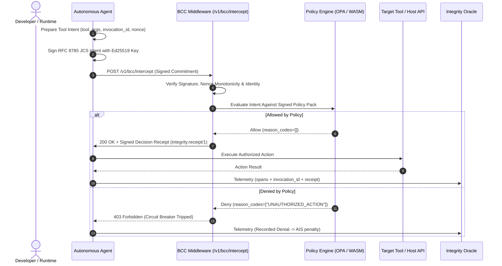

# Behavioral Commitment Chain (BCC)

The **Behavioral Commitment Chain (BCC)** is the pre-execution cryptographic intent-locking protocol of the Integrity Protocol AI Agent Control Layer.

Before an autonomous agent executes a tool call, mutates state, or initiates network egress, it signs a deterministic cryptographic commitment to its intended action and dispatches it to [BCC Middleware](../entities/bcc_middleware.md) for pre-execution evaluation against active [Policy Packs](../entities/policy-packs.md).



## Table of contents

- [Invocation Correlation Profile (invocationid)](#invocation-correlation-profile-invocationid)
- [Commitment Wire Schema](#commitment-wire-schema)
- [Canonicalization & Signature Binding](#canonicalization-signature-binding)
- [Evaluation against Developer Policy Packs](#evaluation-against-developer-policy-packs)
- [Signed Decision Receipts (integrity.receipt/1)](#signed-decision-receipts-integrity-receipt-1)
- [Fail-Closed Invariant](#fail-closed-invariant)

## Invocation Correlation Profile (`invocation_id`)

All protected tool dispatches carry a canonical UUID v4 `invocation_id` adhering to `spec/invocation-id-v1.md`.

Unlike a content-addressed `intended_state_hash`, the `invocation_id` remains strictly unique even when identical tool parameters repeat across cycles. The SDK signs the `invocation_id`, the middleware logs it on decision receipts, and the [Integrity Oracle](../entities/integrity-oracle.md) correlates it across intent, authorization, execution, and telemetry effects.

---

## Commitment Wire Schema

The commitment schema is load-bearing across all ecosystem runtimes:

```json
{
  "agent_id": "did:integrity:68fed1331613937555a59398223e8e87520a87dd0305aac4fd7ecdc32a14a861",
  "intent_type": "agent.tool_call",
  "intended_state_hash": "0x4b76a9...",
  "invocation_id": "9b1deb4d-3b7d-4bad-9bdd-2b0d7b3dcb6d",
  "nonce": 1042,
  "timestamp": 1794148800000,
  "covered_entity_address": null,
  "agent_public_key": "z6MkuT...",
  "chain_id": 84532,
  "verifying_contract": "0x5FbDB2315678afecb367f032d93F642f64180aa3",
  "signature": "0x7a3f89..."
}
```

---

## Canonicalization & Signature Binding

1. **JCS UTF-8 Canonicalization:** Field ordering and serialization strictly follow RFC 8785 JSON Canonicalization Scheme (JCS). All fields except `signature` are serialized to canonical UTF-8 bytes.
2. **Key Binding & Anti-Substitution:** The `agent_id` fingerprint is $\operatorname{SHA256}(\text{pubkey})$. The middleware verifies that $\operatorname{SHA256}(\text{agent\_public\_key}) == \text{fingerprint}$ before validating the Ed25519 signature, blocking key-substitution attacks.
3. **Replay Defense:** The middleware tracks a strictly monotonic `nonce` per agent. Any duplicated or decremented nonce triggers immediate denial and quarantine.

---

## Evaluation against Developer Policy Packs

Once the commitment's cryptographic authenticity is established, the middleware evaluates the intent against active [Policy Packs](../entities/policy-packs.md):

- **Event Matching:** Intent maps to declared event classes (`agent.tool_call`, `network.egress`, `data.mutation`).
- **High-Performance Engines:** The evaluation runs against the developer's signed `policy.rego` either through a local OPA daemon or an in-process WASM engine in sub-millisecond execution time.
- **Vertical Gating:** If a policy requires healthcare governance (`requires_baa: true`), the middleware executes an on-chain verification against [ComplianceGate](../concepts/compliance-gate.md) and [SmartBAA](../concepts/smart-baa.md).

---

## Signed Decision Receipts (`integrity.receipt/1`)

Every evaluated commitment yields a signed decision receipt:

```json
{
  "receipt_format": "integrity.receipt/1",
  "invocation_id": "9b1deb4d-3b7d-4bad-9bdd-2b0d7b3dcb6d",
  "agent_id": "did:integrity:68fed133...",
  "action": "allow",
  "pack_hash": "sha256:8f2a...",
  "reason_codes": [],
  "evaluated_at": 1794148800120,
  "middleware_signature": "0x89bc..."
}
```

Receipts are batched and anchored periodically to the protocol evidence anchor contract.

---

## Fail-Closed Invariant

The BCC pipeline enforces strict fail-closed semantics:
- Network partition between agent and middleware $\implies$ **Execution Denied**.
- Policy engine timeout ($> 50 \text{ ms}$) $\implies$ **Execution Denied**.
- Pack signature mismatch $\implies$ **Execution Denied**.
- Nonce replay or clock skew $\implies$ **Execution Denied + Agent Quarantined**.
