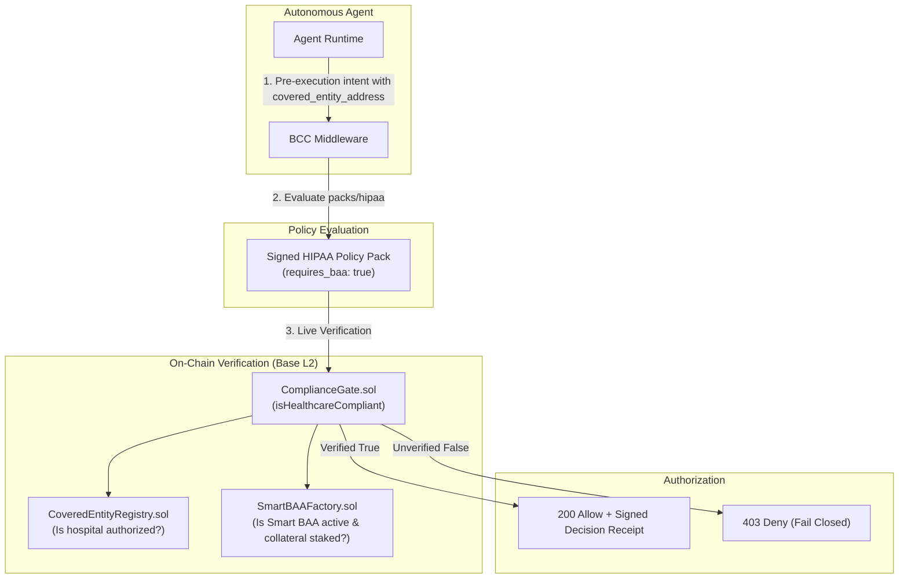

# ComplianceGate & Healthcare Vertical Integration

While the Integrity Protocol core is strictly domain-agnostic, **Integrity Health** serves as the canonical production reference vertical, demonstrating how highly regulated enterprise compliance frameworks (such as HIPAA Title II Security and Privacy Rules) are implemented on top of the protocol using [Policy Packs](../entities/policy-packs.md).

`ComplianceGate.sol` is the per-agent smart contract primitive (an EIP-1167 clone) connecting an agent's on-chain identity to the healthcare compliance vertical.



## Table of contents

- [Domain-Agnostic Core vs. Domain Policy Packs](#domain-agnostic-core-vs-domain-policy-packs)
- [How ComplianceGate Operates](#how-compliancegate-operates)
  - [Non-Self-Declared Invariant](#non-self-declared-invariant)
- [The Integrity Health On-Chain Stack](#the-integrity-health-on-chain-stack)
- [Fail-Closed Verification Invariant](#fail-closed-verification-invariant)
- [Integration with Xibalba Shield & Cortex](#integration-with-xibalba-shield-cortex)

## Domain-Agnostic Core vs. Domain Policy Packs

The Integrity Protocol substrate provides deterministic identity, behavioral commitments, and scoring without baking domain-specific semantics into its core engine. Healthcare governance is realized through:
1. **The HIPAA Policy Pack (`packs/hipaa`):** Specifies Rego rules requiring active BAA verification, mandatory PHI redaction, and covered-entity address checks.
2. **On-Chain Escrow Primitives:** Enforces legal and financial accountability directly on Base L2 via smart contracts.

---

## How ComplianceGate Operates

Each agent's `ComplianceGate` contract declares its regulated vertical (`None` | `Healthcare`) and exposes an authoritative view method called by the [Integrity Oracle](../entities/integrity-oracle.md) and [Integrity Console](https://integrity-console-test.onrender.com):

```solidity
function isHealthcareCompliant(address coveredEntity) external view returns (bool);
```

### Non-Self-Declared Invariant
`ComplianceGate` **never trusts self-declarations**. It performs a real-time cryptographic verification:
- Checks `CoveredEntityRegistry.isActiveCoveredEntity(coveredEntity)` (proving real hospital/clinic legal status).
- Checks `SmartBAAFactory.isBAAActive(coveredEntity, agent)` (proving active escrow and staked collateral).

Self-declared client telemetry flags (such as `integrity.compliance.*`) are stored strictly as audit trails and never satisfy this on-chain check.

---

## The Integrity Health On-Chain Stack

- **`CoveredEntityRegistry.sol`**: Administrative registry of HIPAA-covered entities and authorized business associates.
- **`SmartBAAFactory.sol` / `SmartBAA.sol`**: On-chain Business Associate Agreement escrow per (covered entity, agent) pair. The agent stakes collateral, slashable to the covered entity upon arbitrated breach (see [Smart BAA](smart-baa.md)).
- **`EHRGate.sol`**: Electronic Health Record query gate verifying on-chain authorization before patient data access tokens are minted.

---

## Fail-Closed Verification Invariant

When an agent tool call attempts to access Protected Health Information (PHI):
1. The agent signs a [BCC commitment](bcc.md) containing the target `covered_entity_address`.
2. The middleware evaluates `packs/hipaa`, which flags `requires_baa: true`.
3. If `ComplianceGate.isHealthcareCompliant(coveredEntity)` returns `false` (or if RPC calls timeout), the request is rejected immediately with `403 BAA_REQUIRED_OR_INVALID`.

---

## Integration with Xibalba Shield & Cortex

- **Xibalba Shield:** Enforces local boundary gating on clinical workstations, ensuring that agents running locally cannot exfiltrate unredacted clinical data. Deployed at [`https://xibalba-shield.onrender.com`](https://xibalba-shield.onrender.com).
- **Xibalba Cortex:** Ingests structured clinical ontologies (FHIR, MIMIC-IV) and maintains HIPAA-compliant temporal DAG memory traces. Deployed at [`https://cortex-managed-pilot.onrender.com`](https://cortex-managed-pilot.onrender.com).
