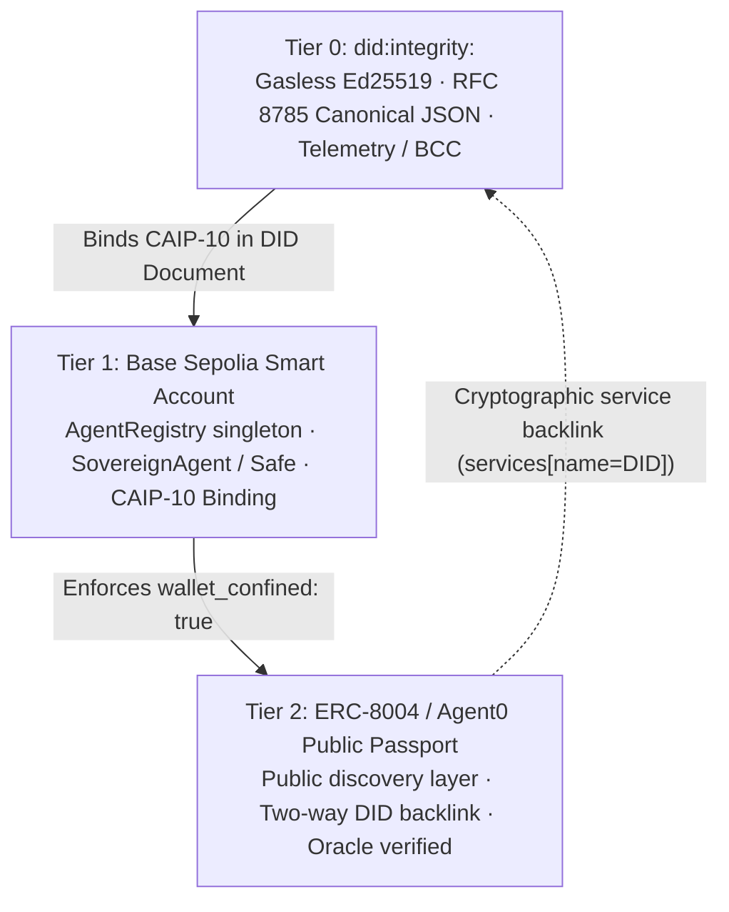

## Table of contents

- [Overview](#overview)
- [The 3-Tier Identity Model](#the-3-tier-identity-model)
- [Tier 0: Pure Cryptographic DID](#tier-0-pure-cryptographic-did)
- [Tier 1: On-Chain CAIP-10 Binding](#tier-1-on-chain-caip-10-binding)
- [Tier 2: Modular ERC-8004 / Agent0 Public Passport](#tier-2-modular-erc-8004-agent0-public-passport)

## Overview

An agent's on-protocol identity: an Ed25519 keypair expressed as a W3C DID document:

```json
{
  "id": "did:integrity:<hex-pubkey-fingerprint>",
  "controller": "did:integrity:<hex-pubkey-fingerprint>",
  "created": "<ISO8601>",
  "verificationMethod": [{
    "id": "did:integrity:<fingerprint>#key-1",
    "type": "Ed25519VerificationKey2020",
    "publicKeyMultibase": "<base58btc/multicodec-encoded pubkey>"
  }]
}
```

**Fingerprint (load-bearing).** The `<fingerprint>` is the **full** `sha256(pubkey)` (64 hex chars) — not the raw key and not a truncation. This is consistent across [integrity-sdk](../entities/integrity-sdk.md) and [integrity-cli](../entities/integrity-cli.md). In [BCC commitments](bcc.md), payloads carry the public key separately, and verifiers check `sha256(pubkey) == fingerprint`.

## The 3-Tier Identity Model



## Tier 0: Pure Cryptographic DID
Zero-gas local Ed25519 identity. Used for high-frequency signing of telemetry spans, OPA policy evaluation, and peer-to-peer agent negotiation over RFC 8785 canonical JSON (JCS). Registered off-chain with the Oracle via `POST /v1/agent/register/offchain`.

## Tier 1: On-Chain CAIP-10 Binding
An agent also holds an on-chain execution address (`SovereignAgent.sol` or Safe v1.4.1 under `Safe7579`). The SDK/CLI bind it to the DID by adding a CAIP-10 `blockchainAccountId` verification method (`eip155:<chainId>:<0xADDRESS>`, type `EcdsaSecp256k1RecoveryMethod2020`), resolving the DID directly to the agent's on-chain account.

## Tier 2: Modular ERC-8004 / Agent0 Public Passport
For public ecosystem discovery, the agent publishes an ERC-8004 registration document (`registration-v1`) carrying:
1. A cryptographic two-way `DID` service backlink:
   ```json
   {
     "name": "DID",
     "endpoint": "did:integrity:<fingerprint>"
   }
   ```
2. CAIP-10 `registrations` references (`eip155:<chainId>:<AgentRegistryAddress>`).
3. An `agentWallet` address pointing strictly to the agent's policy-confined smart account (not an unconfined EOA).

The Integrity Oracle validates this backlink and verifies that `wallet_confined: true` via `POST /v1/agent/{id}/erc8004`.

See [Interface Contract §4.1](../../INTERFACE_CONTRACT.md#41-did-document-producedconsumed-by-integrity-sdk-integrity-oracle) and [SPEC §3.3](../../SPEC.md#33-identity-the-3-tier-identity-and-actor-topology-built).
