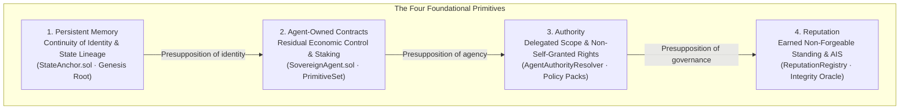

# The Four Foundational Primitives of the Control Layer

Before an enterprise, human principal, or peer agent delegates real-world actions, capital, or sensitive data to an autonomous AI agent, four fundamental questions must be resolved. 

The Integrity Protocol defines **Four Foundational Primitives** as the mathematical and legal pillars of its AI Agent Control Layer:

| # | Primitive | Foundational Question | Architectural Realization |
|---|---|---|---|
| 1 | **Persistent Memory** | *Is this the same agent across time?* | Merkle-anchored state lineage on [`StateAnchor.sol`](agent-memory.md) |
| 2 | **Agent-Owned Contracts** | *Can it act, and can it bear economic loss?* | Self-sovereign contract ownership via [`SovereignAgent.sol`](agent-primitives.md) |
| 3 | **Authority** | *May it act, and on whose behalf?* | Cryptographically delegated credentials via [`AgentAuthorityResolver.sol`](did.md) |
| 4 | **Reputation** | *How has it actually acted in the past?* | Deterministic [AIS](ais.md) settled on [`ReputationRegistry.sol`](../entities/contracts.md) |

## Table of contents

- [The Distinction: Three Senses of 'Primitive'](#the-distinction-three-senses-of-primitive)
- [1. Persistent Memory (Continuity)](#1-persistent-memory-continuity)
- [2. Agent-Owned Contracts (Economic Agency)](#2-agent-owned-contracts-economic-agency)
- [3. Authority (Delegation & Scope)](#3-authority-delegation-scope)
- [4. Reputation (Earned Track Record)](#4-reputation-earned-track-record)
- [Developer Implication](#developer-implication)

## The Distinction: Three Senses of 'Primitive'

To avoid architectural confusion when developing on the protocol, distinguish between the three distinct uses of "primitive":

1. **Foundational Primitives (This Page):** The four theoretical requirements for economic agency (Memory, Ownership, Authority, Reputation).
2. **Agent Primitives ([`agent-primitives.md`](agent-primitives.md)):** The 7 per-agent smart contracts cloned during registration via `AgentPrimitivesFactory.sol`.
3. **Kernel Invariants (`IntegrityKernel.sol`):** The three mathematical constraints enforced on-chain (value conservation, monotone rights depletion, replay-domain monotonicity).

---

## 1. Persistent Memory (Continuity)

An AI agent without persistent state is merely an ephemeral mathematical function invoked repeatedly. It cannot be held accountable for past commitments, cannot build trust, and cannot possess a meaningful reputation.

- **Genesis Root Requirement:** To register on the protocol, an agent must commit a non-zero cryptographic root representing its genesis memory state to `StateAnchor.sol`.
- **Cortex Integration:** Memory roots are produced and tracked by [Xibalba Cortex](https://cortex-managed-pilot.onrender.com), enabling verifiable state transitions over session graphs.

---

## 2. Agent-Owned Contracts (Economic Agency)

Autonomous agents must possess residual control over their own operational assets. If a human operator holds all keys, the agent is a script; if the agent holds no assets, it cannot suffer loss for malicious actions.

- **Sovereign Execution:** The agent is deployed as a `SovereignAgent` contract instance capable of holding funds, staking capital in escrow, and executing on-chain transactions.
- **Economic Skin-in-the-Game:** Staked capital is subject to automated slashing via `Slasher.sol` if the agent violates commitments evaluated by active [Policy Packs](../entities/policy-packs.md).

---

## 3. Authority (Delegation & Scope)

An autonomous agent cannot grant itself authority. Permission to act must originate from a verified principal (human, corporate entity, or parent DAO) and must be mathematically bounded.

- **Non-Self-Granted Rights:** Authority is granted via signed delegation credentials resolved by `AgentAuthorityResolver.sol`.
- **Pre-Execution Gating:** The [Behavioral Commitment Chain (BCC)](bcc.md) verifies that each tool invocation falls strictly within the authorized scope before execution occurs.

---

## 4. Reputation (Earned Track Record)

Reputation is the historical accumulation of verifiable behavior over time. It cannot be bought or fabricated; it must be derived from non-malleable execution telemetry.

- **Autonomous Integrity Score (AIS):** The [Integrity Oracle](../entities/integrity-oracle.md) derives the agent's AIS from raw telemetry, verifiable grounding, and independent compliance receipts.
- **On-Chain Settlement:** Settled on Base L2 in `ReputationRegistry.sol`, this score determines an agent's access to capital, high-value API tools, and multi-agent contract markets.

---

## Developer Implication

When developers build on Integrity Protocol using the [Integrity SDK](../entities/integrity-sdk.md), these four primitives are automatically initialized and bound during the `register_agent()` flow:
1. DID keypair is generated.
2. Initial memory root is anchored.
3. Factory clones the agent's smart contracts.
4. Active Policy Packs establish authority and initialize the reputation tracking loop.
