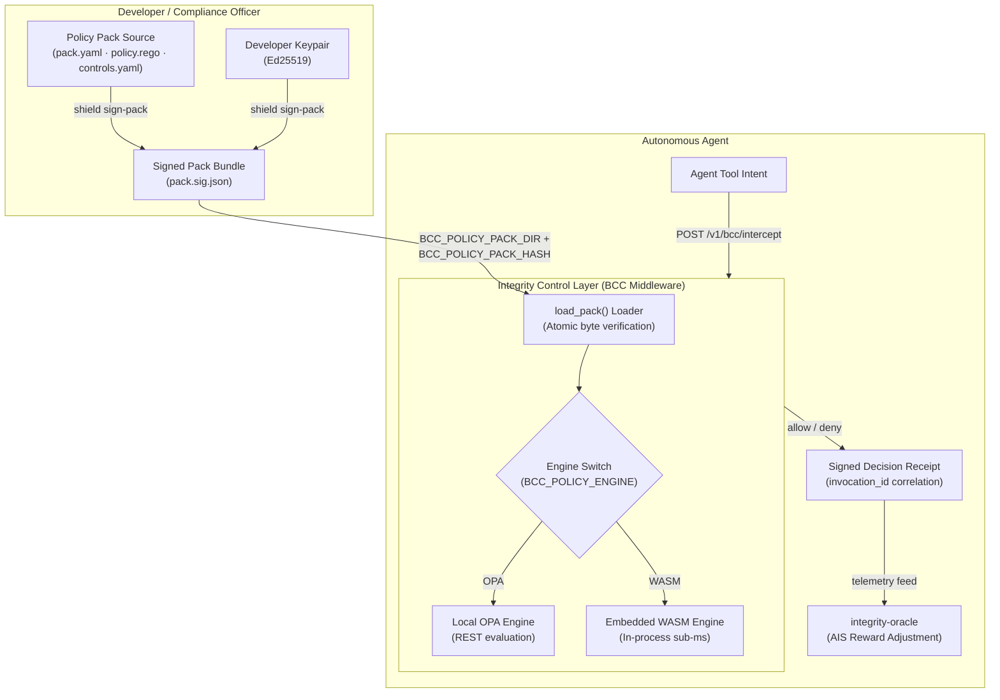

# Policy Packs & Developer Extensibility

Policy Packs are the primary extension point of the Integrity Protocol AI Agent Control Layer. Rather than relying on rigid, hard-coded runtime shims or ungrounded heuristic guardrails, developers author, sign, and deploy modular, versioned **Policy Packs** (`integrity.pack/1`) that enforce deterministic pre-execution invariants on agent tool calls, network egress, and data mutations.

## Table of contents

- [Overview](#overview)
- [Pack Structure & Directory Layout](#pack-structure-directory-layout)
  - [1. pack.yaml (Manifest)](#1-pack-yaml-manifest)
  - [2. policy.rego (Policy Logic)](#2-policy-rego-policy-logic)
  - [3. controls.yaml (Compliance Mapping)](#3-controls-yaml-compliance-mapping)
- [Decision Contract: integrity.decision/1](#decision-contract-integrity-decision-1)
- [Cryptographic Signing & Integrity Verification](#cryptographic-signing-integrity-verification)
- [Runtime Engine: OPA & WASM Evaluation](#runtime-engine-opa-wasm-evaluation)
- [Hot-Reload & Dual-Run Operations](#hot-reload-dual-run-operations)
- [Creating a Custom Policy Pack (Developer Guide)](#creating-a-custom-policy-pack-developer-guide)
  - [Step 1: Scaffold the Pack](#step-1-scaffold-the-pack)
  - [Step 2: Implement Rego Logic](#step-2-implement-rego-logic)
  - [Step 3: Sign & Deploy](#step-3-sign-deploy)
- [Domain Verticals (HIPAA, Base, EDR)](#domain-verticals-hipaa-base-edr)

## Overview

In traditional agent frameworks, safety policies are often implemented as system prompts or external middleware filters that probabilistic models learn to circumvent. Within the Integrity Protocol:

1. **Deterministic Enforcement:** All tool calls and privileged actions must pass through the [Behavioral Commitment Chain (BCC)](../concepts/bcc.md) before execution.
2. **Signed Policy Code:** What gets enforced is mathematically bound to what the developer or enterprise compliance officer signed. Modification of even a single byte invalidates the pack.
3. **Sub-Millisecond Evaluation:** Policy evaluations are executed either via a dedicated local Open Policy Agent (OPA) instance or through in-process WebAssembly (WASM) policy modules.
4. **Verifiable Receipts:** Every decision produces a canonical signed receipt (`integrity.receipt/1`) that feeds directly into the agent's [Autonomous Integrity Score (AIS)](../concepts/ais.md).



---

## Pack Structure & Directory Layout

A Policy Pack is structured as a self-contained directory containing four standard files:

```text
my-policy-pack/
├── pack.yaml         # Manifest: format, name, version, entrypoint, kernel range
├── policy.rego       # The executable Rego policy (or WASM binary)
├── controls.yaml     # Standard compliance control mappings (HIPAA, NIST, OWASP)
└── pack.sig.json     # Detached Ed25519 cryptographic signature (generated)
```

### 1. `pack.yaml` (Manifest)
Defines metadata, compatibility constraints, and event class routing:

```yaml
pack_format: integrity.pack/1
name: enterprise-finance-guard
version: 1.0.0
kernel_range: ">=1.0.0 <2.0.0"
decision_contract: integrity.decision/1
entrypoint: data.integrity.pack.decision
description: Pre-execution policy governing multi-token capital allocation and transfer ceilings.
event_classes:
  agent.tool_call: {no_match: deny}
  network.egress: {no_match: deny}
```

### 2. `policy.rego` (Policy Logic)
Implements rules in Rego adhering to the shared decision contract:

```rego
package integrity.pack

import future.keywords.in

default decision = {
    "action": "deny",
    "reason_codes": ["DEFAULT_DENY"],
    "requires_baa": false
}

decision = {
    "action": "allow",
    "reason_codes": [],
    "requires_baa": false
} {
    input.event_class == "agent.tool_call"
    input.tool_name == "query_financial_model"
    input.parameters.risk_budget <= 0.05
}

decision = {
    "action": "deny",
    "reason_codes": ["RISK_BUDGET_EXCEEDED"],
    "requires_baa": false
} {
    input.event_class == "agent.tool_call"
    input.parameters.risk_budget > 0.05
}
```

### 3. `controls.yaml` (Compliance Mapping)
Maps policy decisions directly to regulatory and security frameworks:

```yaml
schema_version: integrity.controls/1
pack_name: enterprise-finance-guard
mappings:
  RISK_BUDGET_EXCEEDED:
    framework: NIST-AI-RMF
    control_id: GOVERN-1.2
    description: Agent attempted action exceeding approved parameter boundaries.
```

---

## Decision Contract: `integrity.decision/1`

All policy packs must output a standardized JSON decision schema:

| Field | Type | Description |
|---|---|---|
| `action` | `string` | Must be either `"allow"` or `"deny"`. |
| `reason_codes` | `list[string]` | Deterministic identifiers for reasons behind the decision (e.g. `["UNAUTHORIZED_DESTINATION"]`). |
| `requires_baa` | `boolean` | Flags whether an active on-chain Business Associate Agreement is mandatory before dispatch. |

The middleware enforces fail-closed behavior: any schema divergence, unhandled exception, or timeout results in an authoritative `deny` with reason `BCC_POLICY_ENGINE_UNAVAILABLE`.

---

## Cryptographic Signing & Integrity Verification

To prevent unauthorized policy injection, packs are signed using domain-separated Ed25519 cryptography:

1. **Manifest Compilation:** The pack compiler hashes every file (except `pack.sig.json`) using SHA-256 and compiles a sorted JCS (RFC 8785) manifest.
2. **Domain Separation:** The signature prefix is explicitly bound:
   $$\text{Domain} = \texttt{b"integrity.pack.v1\\x00"}$$
   $$\text{Signature} = \operatorname{Sign}_{\text{Ed25519}}(\text{Key}, \text{Domain} \parallel \operatorname{JCS}(\text{CompiledManifest}))$$
3. **Atomic Verification:** The runtime loader (`load_pack`) recomputes all file hashes in memory. If any file has been modified, or if the signer's public key is not in `BCC_TRUSTED_PACK_SIGNERS`, loading fails immediately and the previous active pack remains pinned.

```bash
# Signing a policy pack using Shield CLI
shield sign-pack --pack-dir ./packs/custom-policy --key /secure/keys/operator.pem
```

---

## Runtime Engine: OPA & WASM Evaluation

Integrity Protocol supports two interchangeable execution backends configured via `BCC_POLICY_ENGINE`:

| Engine | Backend | Latency | Deployment Profile |
|---|---|---|---|
| **OPA (Default)** | Dedicated Open Policy Agent sidecar via HTTP REST | ~1.5–3.0 ms | Containerized deployments (`docker-compose`, Kubernetes) |
| **WASM Engine** | Embedded in-process WebAssembly runtime | < 0.2 ms | High-throughput, resource-constrained endpoints and serverless environments |

Developers can switch engines dynamically without altering their pack logic or signature bundles.

---

## Hot-Reload & Dual-Run Operations

Production deployments cannot afford downtime during policy updates. The control layer provides zero-downtime operations:

- **Hot-Reloading:** The middleware watches the pack directory or responds to `POST /v1/admin/reload-pack`. A replacement pack is verified in memory; if valid, the execution pointer swaps atomically.
- **Dual-Run Verification:** When migrating between policies, operators run in dual-run mode (`BCC_POLICY_ENGINE=rego` with `BCC_DUAL_RUN_PACK=true`). The existing policy decides while the new pack evaluates shadow traffic. Divergences are logged to telemetry without impacting live requests.

---

## Creating a Custom Policy Pack (Developer Guide)

### Step 1: Scaffold the Pack
```bash
mkdir -p packs/my-agent-policy
cat << 'EOF' > packs/my-agent-policy/pack.yaml
pack_format: integrity.pack/1
name: my-agent-policy
version: 0.1.0
kernel_range: ">=1.0.0 <2.0.0"
decision_contract: integrity.decision/1
entrypoint: data.integrity.pack.decision
description: Custom policy pack for autonomous researcher agents.
event_classes:
  agent.tool_call: {no_match: deny}
EOF
```

### Step 2: Implement Rego Logic
Create `packs/my-agent-policy/policy.rego`:
```rego
package integrity.pack

default decision = {
    "action": "deny",
    "reason_codes": ["TOOL_NOT_PERMITTED"],
    "requires_baa": false
}

allowed_tools = ["search_pubmed", "fetch_uniprot_sequence", "compute_docking"]

decision = {
    "action": "allow",
    "reason_codes": [],
    "requires_baa": false
} {
    input.tool_name == allowed_tools[_]
}
```

### Step 3: Sign & Deploy
```bash
# Sign the pack
shield sign-pack --pack-dir packs/my-agent-policy --key ~/.hermes/did/private_key.pem

# Point BCC middleware to the signed pack
export BCC_POLICY_PACK_DIR="/opt/integrity/packs/my-agent-policy"
export BCC_POLICY_PACK_HASH="sha256:<printed_hash>"
export BCC_TRUSTED_PACK_SIGNERS="z6Mk..."
export BCC_POLICY_ENGINE="pack"
```

---

## Domain Verticals (HIPAA, Base, EDR)

Integrity Protocol ships with core reference packs in `packs/`:

- **`packs/base`**: Fundamental agent sanity policies (parameter bounds, schema conformance, timeout guards).
- **`packs/bcc`**: Canonical pre-execution tool interception rules enforcing nonce monotonicity and cryptographic signature presence.
- **`packs/hipaa`**: Healthcare-specific compliance rules requiring active Smart BAA verification, PHI masking, and authorized covered-entity addresses.
- **Endpoint Response Packs (Shield)**: Enterprise containment rules integrated with [Xibalba Shield](https://xibalba-shield.onrender.com) for real-time EDR action authorization.
