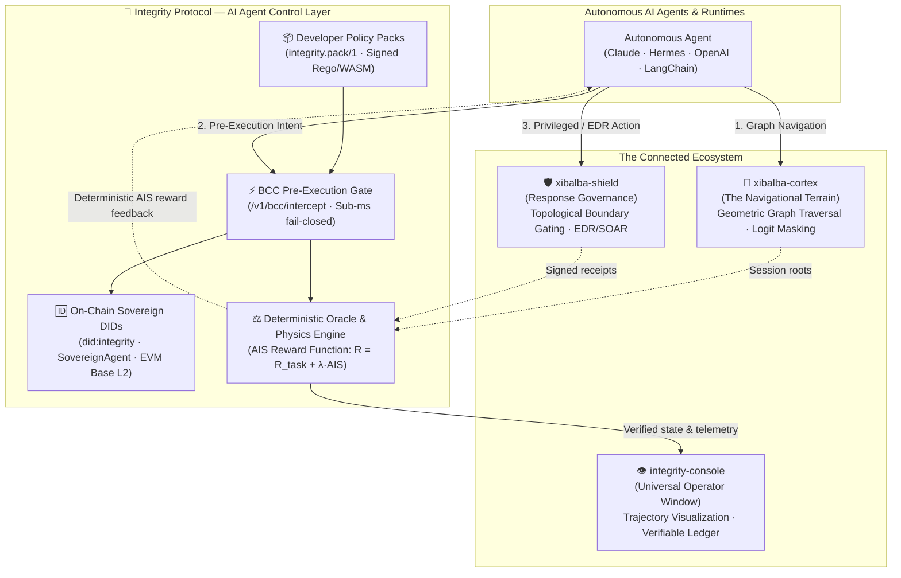

# Integrity Protocol Wiki — The AI Agent Control Layer

Welcome to the compiled knowledge base for **Integrity Protocol** — the deterministic physics engine and verifiable control layer for autonomous AI agents. 

This wiki is the canonical architectural and developer guide for building, governing, and deploying verifiable AI agents. Autonomous agents have become economic principals: they control capital, call APIs, mutate infrastructure, and make mission-critical decisions. Integrity Protocol provides the foundational substrate developers build on top of to guarantee deterministic safety, verifiable execution, and cryptographic alignment.

---

## Core Philosophy: The Physics Engine of the Machine Economy

Conventional AI safety treats alignment and compliance as external "guardrails"—heuristic filters wrapped around unconstrained generative models. In Reinforcement Learning (RL), agents optimize mathematically against their reward function. An external constraint is simply thermodynamic friction: the agent inevitably optimizes to circumvent it.

**Integrity Protocol solves this by making the Autonomous Integrity Score (AIS) the native reward function by definition:**

$$R_{\text{total}} = R_{\text{task}} + \lambda \cdot \text{AIS}$$

Where:
- $R_{\text{task}}$ represents the domain objective (code synthesis, medical diagnostic accuracy, quantitative yield, biological efficacy).
- $\text{AIS} \in [0, 1]$ is the deterministic integrity score computed by the protocol oracle from non-malleable cryptographic telemetry.
- $\lambda > 0$ is the coupling coefficient aligning the agent's Markov Decision Process (MDP) with verifiable truth.

When integrity is the mathematical reward, verifiable compliance is no longer an external tax—it is the optimal policy path. An ungrounded hallucination, broken commitment, or unauthorized action causes immediate reward collapse ($\text{AIS} \to 0$), staking slashing, and revocation of execution rights.

**The path itself is the proof.**

---

## Building on Top of Integrity Protocol

Developers building autonomous agent systems utilize Integrity Protocol as an extensible control plane:

1. **Self-Sovereign Agent DIDs:** Issue tamper-proof decentralized identifiers ([`did:integrity:...`](concepts/did.md)) tied to Ed25519 keypairs, backed by on-chain identity primitives ([`SovereignAgent`](concepts/agent-primitives.md)).
2. **Modular Policy Packs:** Author and deploy domain-specific or enterprise [Policy Packs](entities/policy-packs.md) (`integrity.pack/1`) with signed Rego or WASM rules, event classes, and regulatory control mappings (HIPAA, NIST AI RMF, OWASP).
3. **Pre-Execution Intent Gating:** Intercept agent tool calls with the [Behavioral Commitment Chain (BCC)](concepts/bcc.md) before execution, evaluating permissions in sub-millisecond latency.
4. **Telemetry Ingestion & Memory Anchoring:** Stream OTel telemetry and anchor session roots to Base L2 and Supabase state stores via the [Integrity Oracle](entities/integrity-oracle.md).

---

## The Four-Repository Ecosystem Topology

The Integrity Ecosystem aligns autonomous machine behavior across four specialized repositories:

| Repository | Role | Paradigm & Function | Live Deployment |
|---|---|---|---|
| **`integrity-core`** (This Repo) | **🦴 The Physics Engine & AI Agent Control Layer** | Implements the deterministic AIS reward engine, on-chain DIDs, [Policy Packs](entities/policy-packs.md), [BCC Middleware](entities/bcc_middleware.md), and [Integrity Oracle](entities/integrity-oracle.md). | Oracle: [`https://integrity-oracle.onrender.com`](https://integrity-oracle.onrender.com) |
| **`xibalba-cortex`** | **🧠 The Navigational Engine** | Neuro-symbolic knowledge graph and active inference engine. Replaces probabilistic token guessing with geometric graph traversal (R-GCN + TKGE/TransE), dynamic logit masking, and biomedical/economic connectors. | Pilot: [`https://cortex-managed-pilot.onrender.com`](https://cortex-managed-pilot.onrender.com) |
| **`xibalba-shield`** | **🛡️ Cryptographic Topology & Response Governance** | Enforces topological boundary gating, zero-probability unauthorized state spaces, and vendor-neutral response governance across enterprise EDRs (CrowdStrike, Defender) and AI agents (MCP, SOAR). | Console: [`https://xibalba-shield.onrender.com`](https://xibalba-shield.onrender.com) |
| **`integrity-console`** | **👁️ The Universal Verifiable Operator Window** | Unified presentation and account layer (housing `integrity-dashboard` and `integrity-userapi`). Visualizes agent graph navigation trajectories, multi-agent DID credentials, AIS score distributions, real-time approval queues, and cryptographic Merkle verification. | Operator Window: [`https://integrity-console-test.onrender.com`](https://integrity-console-test.onrender.com) |

---

## Specification & Governance Authority

- [`docs/SPEC.md`](../SPEC.md) (v1.0.0-draft) is the normative protocol specification.
- [`docs/WHITEPAPER.md`](../WHITEPAPER.md) (v3.2) is the explanatory whitepaper.
- [`ECOSYSTEM.md`](../../ECOSYSTEM.md) is the ecosystem authority and product boundary definition.
- [`WIKI_SCHEMA.md`](WIKI_SCHEMA.md) defines wiki governance and frontmatter standards.

---

## Table of Contents

### Architecture & Ecosystem
- [Ecosystem Dependencies & Topology](architecture/ecosystem-dependencies.md) — Four-repository topology, boundaries, and Render cloud endpoints.
- [Repository Implementation Plans](architecture/repository-implementation-plans.md) — Cross-repository roadmap, verification ledger, and milestone status.

### Entities — Core Packages & Extension Points
- [Policy Packs & Developer Extensibility](entities/policy-packs.md) — Composable, signed Rego/WASM policy packs (`integrity.pack/1`) for developers.
- [BCC Middleware](entities/bcc_middleware.md) — FastAPI + OPA/WASM pre-execution intent gating and score push loop.
- [Integrity Oracle](entities/integrity-oracle.md) — Rust/Axum deterministic AIS scoring engine on Render and Supabase.
- [Integrity SDK](entities/integrity-sdk.md) — Python agent library: DIDs, BCC interception, telemetry, and policy pack validation.
- [Integrity CLI](entities/integrity-cli.md) — Developer CLI for keys, registration, verification, and vaults.
- [Contracts](entities/contracts.md) — Solidity/Foundry primitive suite on Base L2: factory, registries, XNS, and SovereignAgent.
- [Trust layer](entities/trust-layer.md) — Integrity Token v2: staking, the latching freeze, unbonding, and the gated execute path.
- [Integrity Dashboard (Console)](entities/integrity-dashboard.md) — React/Vite operator window (hosted in `integrity-console`).
- [Integrity User API (Console)](entities/integrity-userapi.md) — FastAPI + Postgres account authentication (hosted in `integrity-console`).
- [Integrity ZKP](entities/integrity-zkp.md) — Zero-knowledge proving pipeline and circuit definitions.

### Concepts — The AI Agent Control Layer Primitives
- [The Four Foundational Primitives](concepts/foundational-primitives.md) — Memory, Ownership, Authority, and Reputation.
- [Agent Primitives (Self-Sovereign Identity)](concepts/agent-primitives.md) — The 7 per-agent smart contracts (`PrimitiveSet`).
- [Persistent Memory & Genesis Root](concepts/agent-memory.md) — Continuity of the economic agent; registration gating.
- [Persistent Memory Configuration](concepts/persistent-memory.md) — TrustVault context manager and backend storage adapters.
- [Decentralized Identifier (DID)](concepts/did.md) — Multibase Ed25519 identity format and fingerprint resolution.
- [Identity Ceiling & Verification Ladder](concepts/identity-ceiling.md) — Tier-based capability ceilings and elevation.

### Concepts — Trust, Metrology & Scoring
- [Autonomous Integrity Score (AIS)](concepts/ais.md) — Deterministic RL reward formula ($R_{\text{total}} = R_{\text{task}} + \lambda \cdot \text{AIS}$).
- [Telemetry Ingestion Pipeline](concepts/telemetry-ingestion.md) — End-to-end OTel span processing to oracle scoring.
- [Local Metrology](concepts/local-metrology.md) — Entropy, grounding, attested sacrifice, and compliance derivations.
- [Observability & PHI Safety](concepts/observability-vtl.md) — Secret and PHI redaction backstops.

### Concepts — Behavioral Gating & Cryptography
- [Behavioral Commitment Chain (BCC)](concepts/bcc.md) — Intent locking, canonical UUID correlation, and pre-execution interception.
- [Merkle Batching & State Anchoring](concepts/merkle-batching.md) — Root batching and on-chain state verification.
- [Zero-Knowledge Proving Pipeline (ZKP)](concepts/zkp.md) — Proof generation and scoring boosts.
- [ZK-ML Model-Inference Verification](concepts/zk-ml-spec.md) — `[PLANNED]` Verification of private inference.

### Concepts — Governance, Markets & Verticals
- [ComplianceGate & Integrity Health](concepts/compliance-gate.md) — Healthcare compliance vertical pack (`packs/hipaa`).
- [Smart BAA](concepts/smart-baa.md) — Cryptographic Business Associate Agreement escrow.
- [Integrity Market](concepts/integrity-market.md) — Verifiable prediction and reputation markets.
- [Governance](concepts/governance.md) — Protocol parameter tuning and dispute slashing.
- [Xibalba Agent Operating Model](concepts/xibalba-agent-operating-model.md) — Dual-mandate execution architecture.
- [Testing Strategy](concepts/testing-strategy.md) — 3-tier verification pyramid.
- [Test-Status Tree Binding](concepts/test-status-tree-binding.md) — Cryptographic test suite attestation.
- [Cross-Chain Reputation Sync](concepts/cross-chain-spec.md) — `[PLANNED]` Cross-L2 reputation transport.
- [A2A Negotiation Protocol](concepts/a2a-negotiation-spec.md) — `[PLANNED]` Agent-to-agent contract negotiation.

### Queries & Diagnostics
- [Gas Tracking](queries/gas-tracking.md) — EVM execution cost analysis.

---

## Reference & Meta

- [`WIKI_INDEX.md`](WIKI_INDEX.md) — Full canonical catalog for machine linting.
- [`WIKI_LOG.md`](WIKI_LOG.md) — Append-only chronological modification history.
- [`WIKI_SCHEMA.md`](WIKI_SCHEMA.md) — Frontmatter specifications and style guide.
